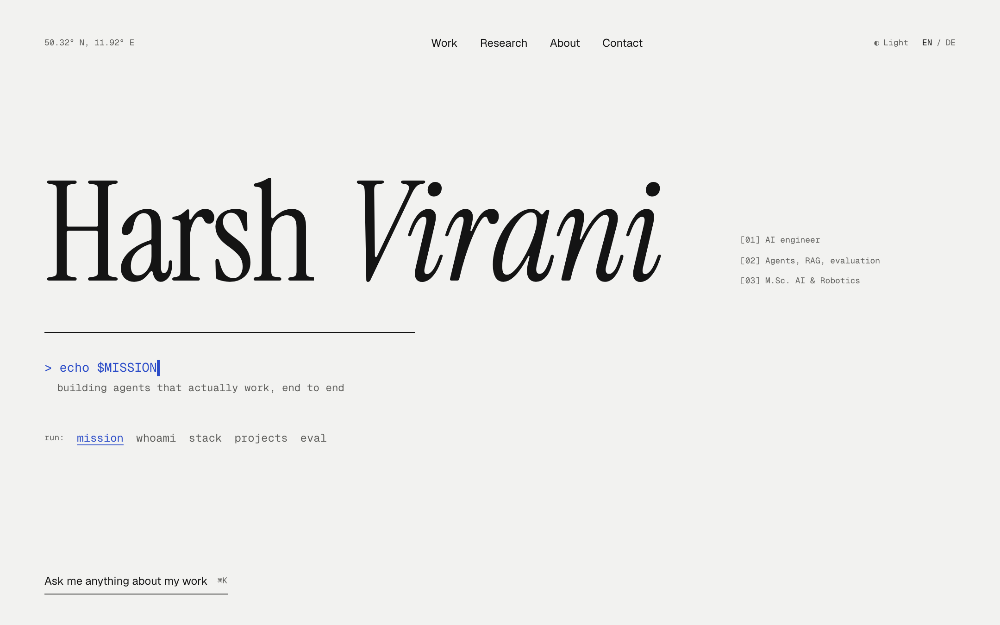

<div align="center">

# Harsh Virani

The bilingual portfolio of an AI engineer, with an agent that answers questions about his work and cites its sources.

[**Live site**](https://harsh-virani.vercel.app) · [Deutsch](https://harsh-virani.vercel.app/de) · [Report a bug](https://github.com/HarshVirani914/personal-portfolio/issues)

[](https://github.com/HarshVirani914/personal-portfolio/actions/workflows/ci.yml)


[](LICENSE)

<picture>
  <source media="(prefers-color-scheme: dark)" srcset="docs/screenshots/home-dark.png">
  
</picture>

</div>

## Features

- **Ask me anything agent.** Press ⌘K and ask about the work. Answers stream in, cite the project or paper they came from, and fall back to a prewritten email when the agent does not know.
- **Runs on free tiers by design.** Abuse can take the agent offline for the day but can never produce a bill. [ADR 0001](docs/adr/0001-free-tier-agent.md) has the reasoning.
- **English and German.** English lives at `/`, German at `/de`, and untranslated fields fall back to English.
- **CMS-driven.** Everything a visitor reads is edited in an embedded Sanity Studio and goes live without a redeploy.
- **Interactive figures.** Each project has its own isometric SVG figure, built with a small in-house drawing kit and checked by geometry tests.
- **Readable by machines.** Pages carry schema.org structured data, and `/llms.txt` and `/llms-full.txt` give AI tools a plain-text guide built from the same CMS content.
- **Works with no setup.** With no environment variables the site runs on built-in fixture content, so a fresh clone starts immediately.
- **Details.** Light and dark themes, reduced-motion support, generated Open Graph images, a sitemap, a web app manifest, and automated accessibility checks.

## Tech stack

| Area      | Tools                                                    |
| --------- | -------------------------------------------------------- |
| Framework | Next.js 16 (App Router), React 19, TypeScript            |
| Styling   | Tailwind CSS 4, Base UI, shadcn/ui, Lenis                |
| Content   | Sanity                                                   |
| Agent     | Groq (`openai/gpt-oss-20b`), Upstash Redis, Vercel BotID |
| Testing   | Vitest, Playwright, axe-core                             |
| Hosting   | Vercel, with Vercel Analytics and GitHub Actions for CI  |

## Getting started

You need Node.js 22.12 or newer (CI uses 24) and [pnpm](https://pnpm.io).

```bash
git clone https://github.com/HarshVirani914/personal-portfolio.git
```

```bash
cd personal-portfolio
```

```bash
pnpm install
```

```bash
pnpm dev
```

Open [http://localhost:3000](http://localhost:3000). The site runs on fixture content from `lib/content/`, the agent overlay reports that it is resting, and `/studio` asks for a Sanity project ID. Add the services below to turn each of those on.

## Configuration

Copy `.env.example` to `.env.local`. Every variable is optional for local work.

| Variable                                             | Purpose                                                                                                   |
| ---------------------------------------------------- | --------------------------------------------------------------------------------------------------------- |
| `NEXT_PUBLIC_SITE_URL`                               | Public URL for canonical links, social cards and the sitemap. Vercel previews fall back to their own URL. |
| `NEXT_PUBLIC_SANITY_PROJECT_ID`                      | Reads content from Sanity and enables `/studio`. Unset means fixture content.                             |
| `NEXT_PUBLIC_SANITY_DATASET`                         | Sanity dataset. Defaults to `production`.                                                                 |
| `SANITY_API_READ_TOKEN`                              | Only needed for a private dataset.                                                                        |
| `SANITY_REVALIDATE_SECRET`                           | Signing secret shared with the Sanity webhook.                                                            |
| `GROQ_API_KEY`                                       | Model access for the agent.                                                                               |
| `UPSTASH_REDIS_REST_URL`, `UPSTASH_REDIS_REST_TOKEN` | Answer cache, limits and question log. The agent makes no model calls without them.                       |

Set `CONTENT_SOURCE=fixture` in your shell to force fixture content while Sanity is configured.

To publish without a redeploy, add a Sanity webhook that sends `POST` requests to `/api/revalidate`, signed with `SANITY_REVALIDATE_SECRET`, with a projection that includes `_type`.

## Scripts

| Command           | What it does                                     |
| ----------------- | ------------------------------------------------ |
| `pnpm dev`        | Start the development server                     |
| `pnpm build`      | Create a production build                        |
| `pnpm start`      | Serve the production build                       |
| `pnpm lint`       | Run ESLint (`pnpm lint:fix` to fix)              |
| `pnpm format`     | Run Prettier (`pnpm format:check` to only check) |
| `pnpm typecheck`  | Check types                                      |
| `pnpm test`       | Run unit tests with Vitest                       |
| `pnpm test:e2e`   | Run Playwright tests on desktop and mobile       |
| `pnpm eval:agent` | Run the agent evals against the real Groq API    |

`pnpm test:e2e` serves the production build, so run `pnpm build` first, and `pnpm exec playwright install chromium` once. CI runs lint, types, unit tests, the build and the end-to-end tests on every pull request. The evals spend real quota and never run in CI.

## How it works

### Content

Pages never talk to Sanity directly. They call `lib/content`, which reads from a `ContentSource` (Sanity or the fixture), applies the English fallback, drops hidden items and returns typed data. A signed webhook then revalidates only the cache tag for the document type that changed.

### Agent

Each question stands alone, with no chat history. `POST /api/agent` runs the cheapest checks first:

1. Reject bots and cross-origin requests.
2. Validate the question, which is capped at 300 characters.
3. Serve a cached answer if the same question, locale and content have been answered before. This costs no quota.
4. Enforce 20 uncached questions a day per visitor, tracked by a salted hash of the IP address that changes daily.
5. Reserve tokens from a daily budget of 160K, kept below Groq's free allowance of about 200K.
6. Stream the model's answer as newline-delimited JSON.

The model only sees the Knowledge View, a trimmed subset of published content, which keeps each question to about 3K tokens. Every question ends in one of four outcomes: Answered, Unknown, Refused or Unavailable. Unknown and Unavailable offer the visitor a prewritten email to Harsh.

[`CONTEXT.md`](CONTEXT.md) defines these terms.

## Project structure

```
app/                  Routes: [locale] pages, /api/agent, /api/revalidate, /studio
components/
  figures/            One folder per project figure, plus shared parts
  iso/                Isometric drawing kit
  site/               Page sections and the agent overlay
  ui/                 Base components
lib/
  agent/              Guards, prompt, Groq client, Redis store, streaming
  content/            Content layer, Sanity source and fixtures
sanity/schema/        CMS document types
e2e/                  Playwright tests
evals/                Agent evals against the real model
docs/adr/             Architecture decision records
```

## Documentation

- [`CONTEXT.md`](CONTEXT.md): domain language
- [`PRODUCT.md`](PRODUCT.md): audience, positioning and principles
- [`DESIGN.md`](DESIGN.md): design system
- [`docs/adr/`](docs/adr/): architecture decisions

## License

The code is released under the [MIT License](LICENSE).

The license does not cover personal content, and all rights to it are reserved. That means the written copy (including the fixtures in `lib/content/`), the CV, portrait photos, project images and research PDFs. Logos belong to their owners. If you fork this project, replace that content with your own.

## Contact

Harsh Virani · [harsh-virani.vercel.app](https://harsh-virani.vercel.app) · [harshvirani.91@gmail.com](mailto:harshvirani.91@gmail.com)
